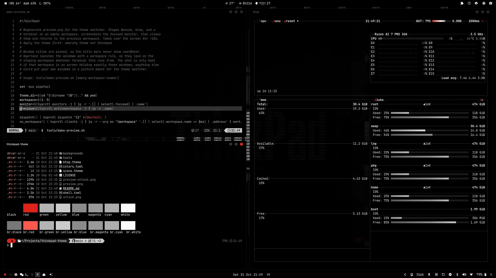
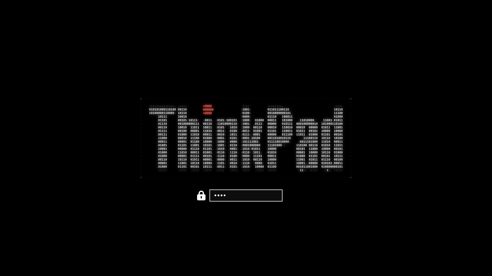

# Thinkpad — an Omarchy theme

Vantablack, ThinkPad edition. Pure black surfaces, crisp white key legends,
every color a shade of gray, and a single TrackPoint-red accent used only where
attention matters.



## Install

```bash
omarchy theme install https://github.com/JarnKet/omarchy-thinkpad-theme
```

Cycle its wallpapers with `omarchy theme bg next`.

### Boot screen (optional)

The theme includes an ASCII ThinkPad wordmark for the disk-unlock and login
screens. Applying it needs sudo and rebuilds the initramfs:

```bash
omarchy plymouth set by theme thinkpad
```



Undo with `omarchy plymouth reset`.

## Palette

| Role              | Hex       | Inspiration                     |
|-------------------|-----------|---------------------------------|
| background        | `#000000` | Vantablack                      |
| foreground        | `#FFFFFF` | Key legends                     |
| selection         | `#1A1A1A` | Keyboard deck                   |
| accent            | `#8D8D8D` | Graphite                        |
| muted             | `#7A7A7A` | Comments, hints                 |
| ANSI colors       | `#5C5C5C`–`#CECECE` | Grays, as in Vantablack |
| red               | `#E3241A` | TrackPoint / logo dot red       |
| bright red        | `#FF5A4F` | Error text                      |

Red passes WCAG 4.5:1 against the black background.

## Where the red goes

The active window border, the selected launcher and menu row, the lock screen
while typing, notification countdowns, bar modules calling for attention, btop
at peak load, and errors (including terminal red). Everything else, popups,
notifications, menus, and btop boxes included, stays black, white, and gray.

## Files

- `colors.toml`: the palette. Omarchy generates Hyprland borders, terminals,
  Neovim (aether.nvim), VS Code, Chromium, Helix, gum, etc. from it.
- `shell.toml`: bar, popups, menus, notifications, and lock screen.
  Keep it in sync with `colors.toml`.
- `btop.theme`: a monochrome btop on black.
- `icons.theme`: `Yaru-gray`, as in Vantablack.
- `unlock.png`, `preview-unlock.png`: boot and login screen logo (the
  wallpaper's ASCII wordmark in its dotted frame) and its preview, rendered
  by `tools/make-unlock.sh` from `tools/wordmark.svg`.
- `preview.png`: the theme switcher thumbnail.
- `tools/make-preview.sh`: regenerates `preview.png` (takes over the screen
  for about 10 seconds). `tools/palette.sh` prints the terminal palette.
- `backgrounds/`: thirteen ASCII wallpapers, all drawn the same way: every
  mark is a character on one monospace grid (braille dots for land, shading
  and fills, box-drawing for keys and traces), black, white and grays, and
  one thing in TrackPoint red. None of them carries a name, a model or a
  place; they render the same on any machine.
  1. **world**: the time-zone map, the world in braille cut into 24 hour
     columns, the date line in red, Yamato Lab's zone lit, the wordmark over it
  2. **trackpoint**: the red nub up close, among G, H and B
  3. **hinge**: a lid opening from closed to flat, every 30 degrees
  4. **bento**: the shokado bento box the design came from, one red plum
  5. **keyboard**: the keyboard from above, TrackPoint, buttons and touchpad
  6. **orbit**: a space station over the curve of the Earth, its orbit in red
  7. **notepad**: the pocket notepad with THINK on its cover, and a pencil
  8. **exploded**: the base taken apart into its six layers
  9. **mountains**: ridges going back into the haze, a red sun behind them
  10. **setup**: a setup utility, the TrackPoint row selected
  11. **halftone**: the wordmark's i blown up until the print shows
  12. **drop**: a closed laptop dropped from 122 cm, landing on a corner
  13. **source**: a wall of source code, the TrackPoint driver
- `tools/make-ascii-wallpaper.py`: draws them into `backgrounds/`
  (`make-ascii-wallpaper.py all`, or name the ones to redo).
  `--boot-logo` draws `unlock.png`.
- `tools/world-land.png`: the land for the world map and the globe, from
  Natural Earth's 1:50m land and lakes, rasterized at 10 pixels per degree.

## Developing

Link a checkout instead of installing, so edits apply on the next
`omarchy theme set thinkpad`:

```bash
ln -s ~/Projects/thinkpad-theme ~/.config/omarchy/themes/thinkpad
```

## Credits

Not affiliated with or endorsed by Lenovo. ThinkPad, TrackPoint, and Lenovo
are trademarks of Lenovo. The wordmark outline comes from
[Wikimedia Commons](https://commons.wikimedia.org/wiki/File:ThinkPad_Logo.svg),
where it is a public-domain text logo. Map data from
[Natural Earth](https://www.naturalearthdata.com/) (public domain).

## License

The theme files are MIT licensed; see [LICENSE](LICENSE).
